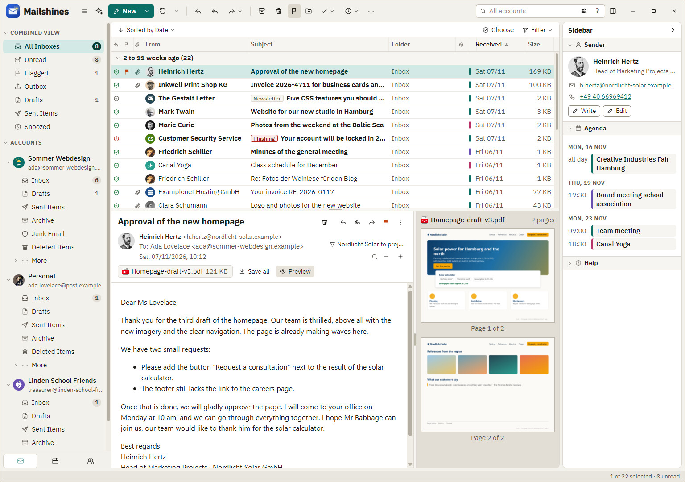
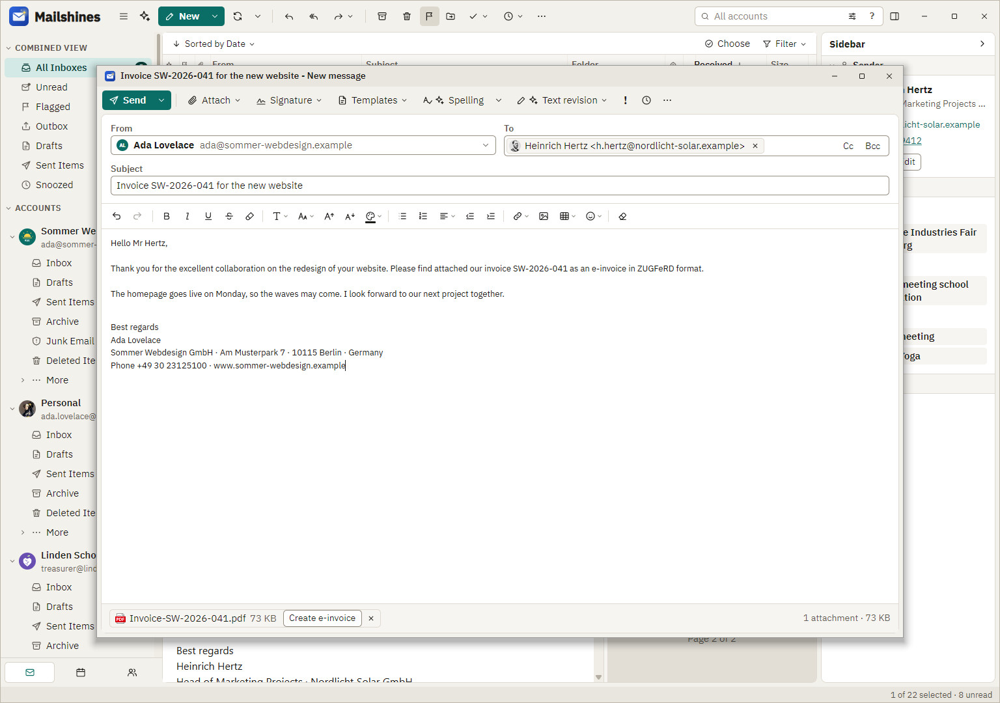
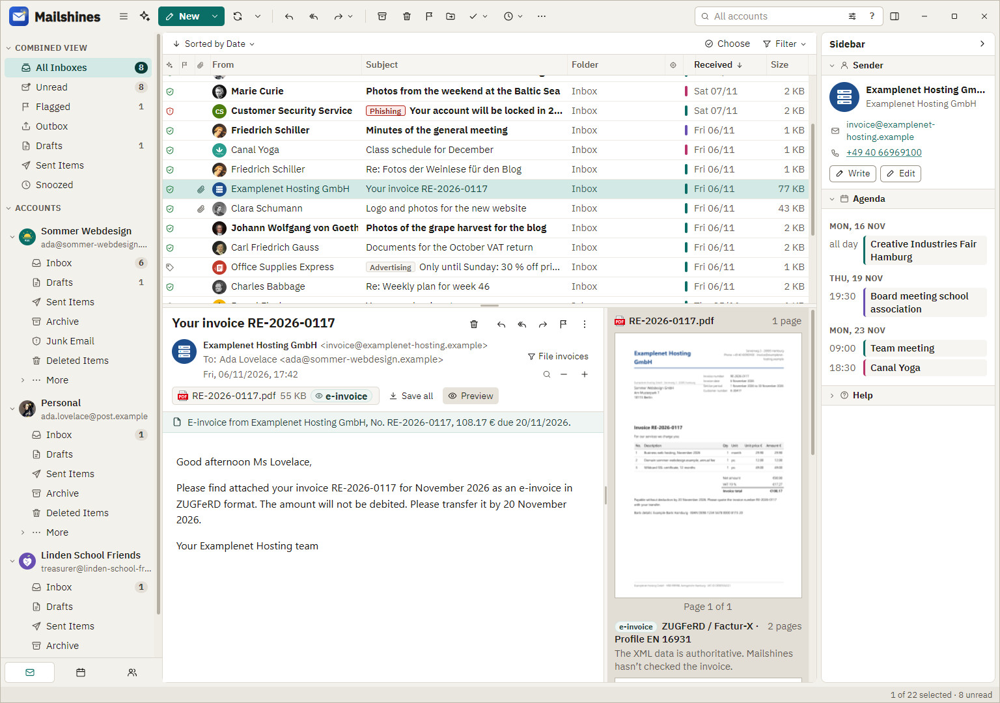
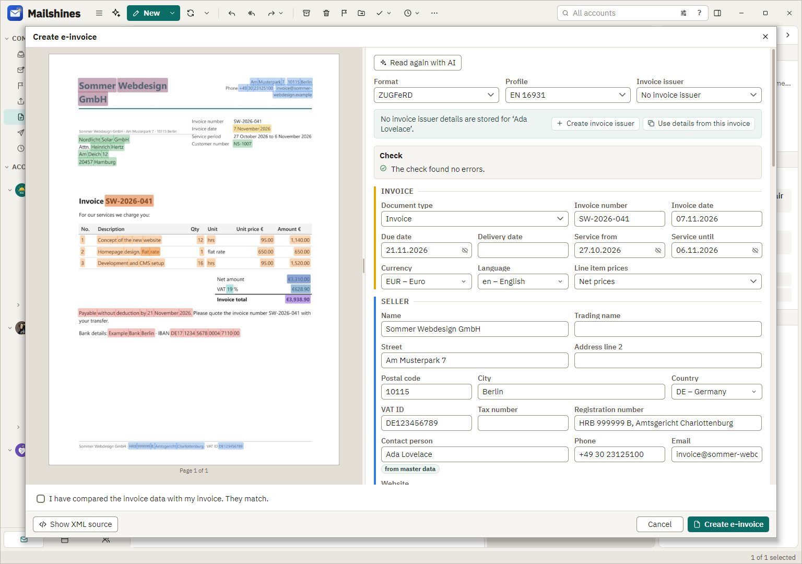
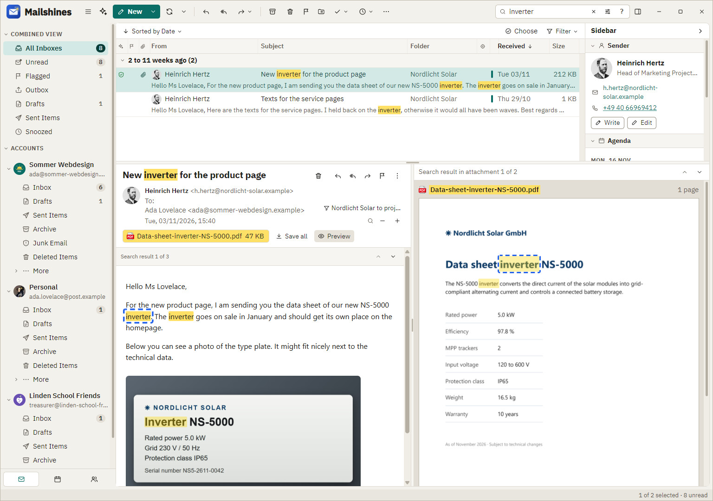
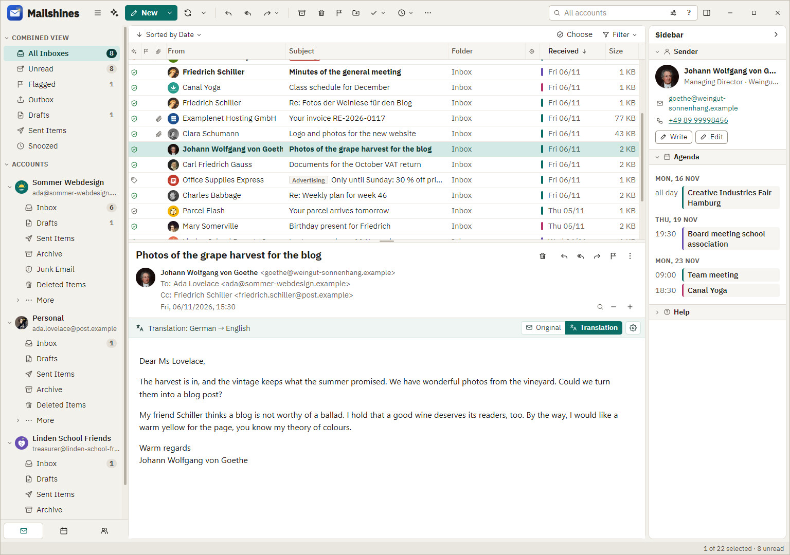
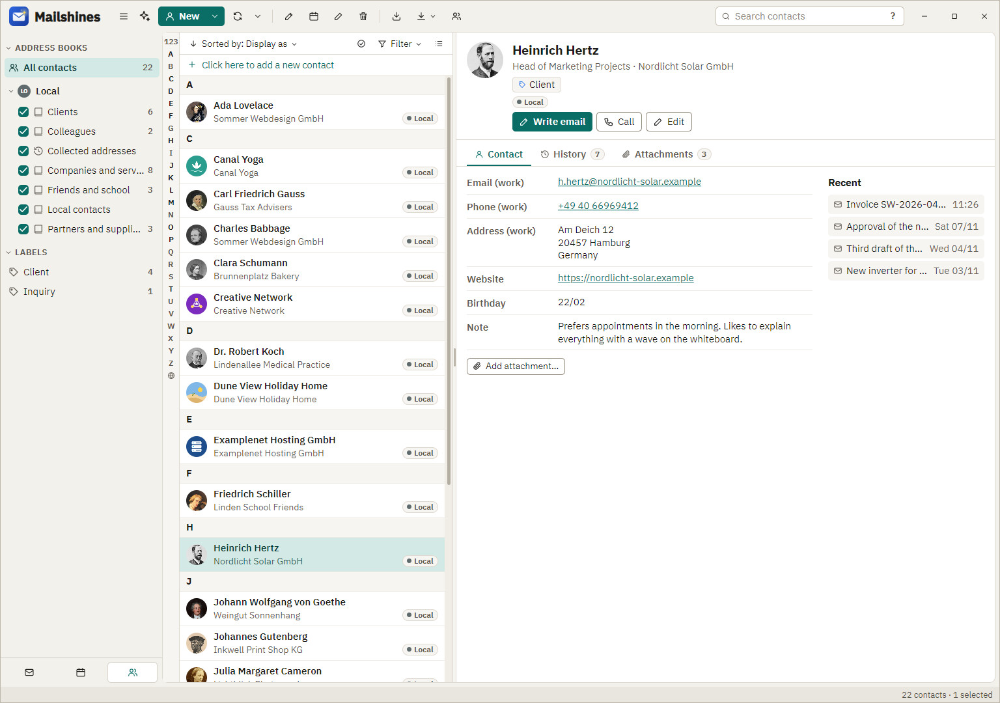
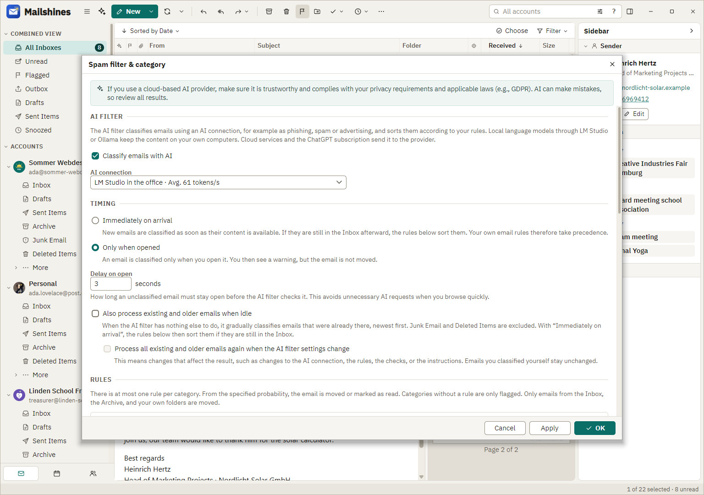
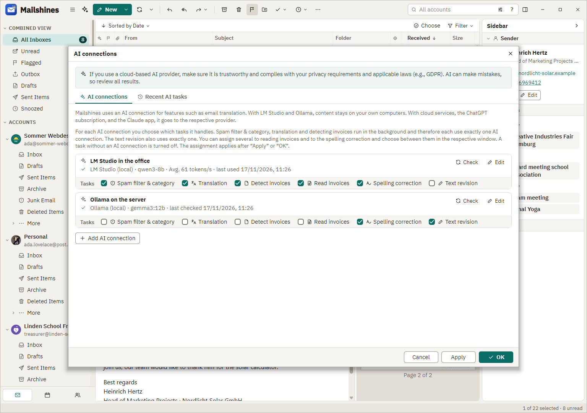

# Mailshines

Mailshines brings email, calendar and contacts together in one professional program: comprehensive, easy to use, secure and very fast. With a search that also looks inside attachments and images, and AI assistance on your terms. Mailshines runs as a desktop app on one computer or as a server for all devices in your office or home network — **free of charge**.

🌐 **[Visit the Mailshines website](https://mailshines.appshines.com/en/)** to see every feature in detail.



<p>
  
  
</p>
<p>
  
  
</p>
<p>
  
  
</p>
<p>
  
  
</p>
<p>
  
</p>

All screenshots show a fictional sample office with invented data.

## About Mailshines

### Find instead of search

Mailshines analyzes every email as soon as it arrives, including all images and documents, whether embedded in the text or attached. Text in images is recognized with OCR. Everything goes into a database optimized for searching. So you find a term instantly, whether it appears in the message, in a PDF or on a photographed receipt.

### AI on your terms

Connect the AI provider of your choice: entirely local on your computer or from the cloud. The AI helps you detect spam and phishing, translate, handle invoices and e-invoices, check spelling and revise texts. All AI features are optional.

### Your data stays with you

Mailshines does not collect usage data. Content only reaches an AI service if you set up an AI connection and use an AI feature.

### Fully usable offline

All emails, events and contacts are stored as a complete copy on your computer. You read, search and write even without an internet connection. As soon as the connection is back, Mailshines transfers your changes automatically.

### One server for all devices

Besides the desktop app for a single computer, Mailshines can run as a server in your office or home network. Desktop apps and browsers on PC, tablet and smartphone then work with the same mailboxes, calendars and address books. The server belongs to you and runs on your own Windows or Linux computer, not in someone else's cloud. The InstallManager sets it up.

### Features at a glance

- 📧 Quick account setup: you enter your email address, and Mailshines finds the usual server settings on its own
- 🔗 Combine any accounts: IMAP providers, Microsoft 365 and Google
- 📥 Combined overview of all inboxes, your own folders, local folders and archives
- 🔍 Very fast full-text search with search syntax, including in attachments (PDF, Word, Excel …) and in images via OCR
- 📄 Page preview of images and documents right next to the email text
- 🧹 Any number of filter rules: local or on the server, if your provider supports it
- 📅 Calendar with day, week, month and event list views
- 👥 Contacts with address books and groups
- 🧾 Detect e-invoices in the ZUGFeRD and XRechnung formats, display them in readable form and create them from your own invoices
- 🤖 Optional AI features with local language models via LM Studio or Ollama, or with a cloud service
- 🛡️ Process-isolated handling of images and attachments for security with unknown senders
- 🌍 User interface in 45 languages

## Get Mailshines

Mailshines comes in two forms:

- The **app version** is the mail program for one computer. It needs no installer and no server.
- The **InstallManager** installs Mailshines in the variant you choose: as a desktop app, as a server with desktop app and web interface, as a server only, or as a desktop client of a Mailshines server on another computer. It also updates, repairs and removes the installation.

| Platform | App version | InstallManager |
|----------|-------------|----------------|
| **Windows** | [Microsoft Store](https://apps.microsoft.com/detail/9P21P12N3ZX3) (recommended) or portable ZIP from [Releases](../../releases/latest) | [Releases](../../releases/latest) |
| **Linux** | [Releases](../../releases/latest): AppImage, DEB, RPM or tar.gz | [Releases](../../releases/latest): AppImage, DEB, RPM or tar.gz |
| **macOS** | Mac App Store — coming soon | — |

All downloads are for computers with a 64-bit x64 processor from Intel or AMD.

## Linux downloads

Get the latest version from the **[Releases page](../../releases/latest)**.

### App version

| File | For |
|------|-----|
| `Mailshines-x.y.z-linux-x64.AppImage` | Any Linux distribution — no installation required |
| `Mailshines-x.y.z-linux-x64.deb` | Debian, Ubuntu, Linux Mint, Pop!_OS |
| `Mailshines-x.y.z-linux-x64.rpm` | Fedora, openSUSE |
| `Mailshines-x.y.z-linux-x64.tar.gz` | Generic archive for all other distributions |

**AppImage (recommended)**

```bash
chmod +x Mailshines-*-linux-x64.AppImage
./Mailshines-*-linux-x64.AppImage
```

**Debian / Ubuntu / Mint / Pop!_OS**

```bash
sudo apt install ./Mailshines-*-linux-x64.deb
```

**Fedora**

```bash
sudo dnf install ./Mailshines-*-linux-x64.rpm
```

**openSUSE**

```bash
sudo zypper install --allow-unsigned-rpm ./Mailshines-*-linux-x64.rpm
```

**Generic archive**

```bash
tar -xzf Mailshines-*-linux-x64.tar.gz
./Mailshines-*-linux-x64/mailshines
```

The app version does not update itself. To update, download the new version from the Releases page and install it over the old one. Your emails and settings are kept.

### InstallManager

| File | For |
|------|-----|
| `Mailshines.InstallManager-x.y.z-linux-x64.AppImage` | Any Linux distribution — no installation required |
| `Mailshines.InstallManager-x.y.z-linux-x64.deb` | Debian, Ubuntu, Linux Mint, Pop!_OS |
| `Mailshines.InstallManager-x.y.z-linux-x64.rpm` | Fedora, openSUSE |
| `Mailshines.InstallManager-x.y.z-linux-x64.tar.gz` | Generic archive, also for servers without a screen |

```bash
chmod +x Mailshines.InstallManager-*-linux-x64.AppImage
./Mailshines.InstallManager-*-linux-x64.AppImage
```

The InstallManager downloads the current Mailshines version itself and checks its signature. On a server without a screen, it runs in the terminal. Installations made with the InstallManager keep themselves up to date.

Use either the app version or an installation made with the InstallManager for the same user, not both.

## Windows downloads

| File | For |
|------|-----|
| [Microsoft Store](https://apps.microsoft.com/detail/9P21P12N3ZX3) | App version, signed, with automatic updates through the Store (recommended) |
| `Mailshines-x.y.z-win-x64.zip` | App version as a portable ZIP: extract it and start `Mailshines.cmd` |
| `Mailshines.InstallManager-x.y.z-win-x64.exe` | InstallManager for all variants, including the server |

> **Windows note:** The ZIP and the InstallManager from this page are **not code-signed**, so Microsoft Defender SmartScreen may show a warning when you start them ("Windows protected your PC" — click "More info" → "Run anyway"). If you prefer an installation without this warning, use the signed [Microsoft Store version](https://apps.microsoft.com/detail/9P21P12N3ZX3). The portable ZIP does not update itself and needs the Microsoft Edge WebView2 Runtime, which is already part of Windows 11 and of current Windows 10 installations.

## System requirements

**Windows**

- Windows 10 or Windows 11 on a computer with an x64 processor

**Linux**

- 64-bit Linux (x86_64) with glibc 2.31 or newer, for example Ubuntu 20.04 or Debian 11 and newer
- X11 or Wayland desktop session, GTK 3 and WebKitGTK (libwebkit2gtk 4.1 or 4.0) for the desktop app. The DEB and RPM packages install these libraries automatically if they are missing
- The server also runs as a service on computers without a screen

**Browser (web interface of your own Mailshines server)**

- Current versions of Chrome, Edge, Firefox and Safari, including on the iPhone and on Android

## Support

Questions, bug reports and feature requests: please use the **[issue tracker](../../issues)** of this repository or "Send feedback" in the "About Mailshines" dialog.

## License

Mailshines is proprietary software, provided free of charge. Use is subject to the license agreement that Mailshines shows at first start. All rights reserved.
